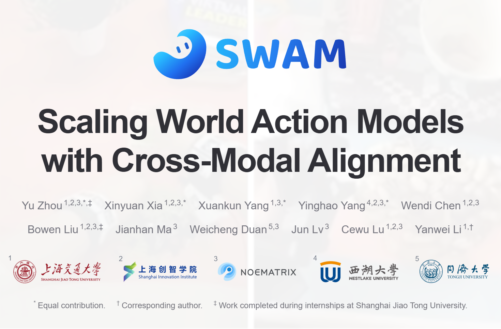
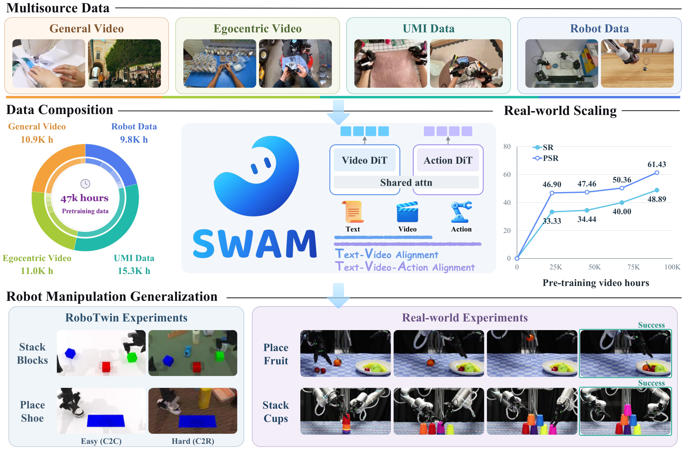
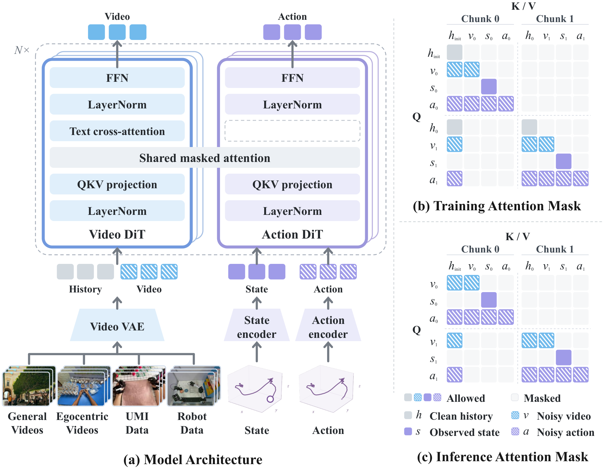
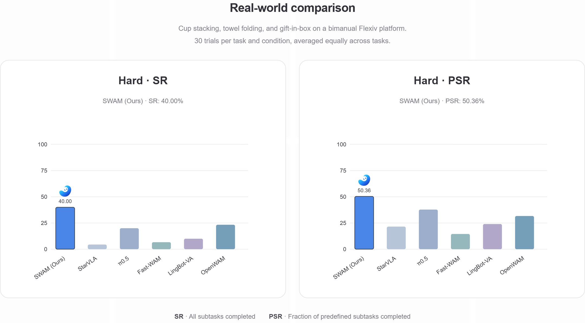

# SWAM

[](https://char-lotte-xia.github.io/swam-official/)

<p align="center">
  <a href="https://char-lotte-xia.github.io/swam-official/"></a>
  <a href="https://arxiv.org/abs/2611.12870"></a>
  <a href="https://huggingface.co/datasets/FreDERicia/SWAM-Pretrain"></a>
</p>

SWAM studies how to preserve language–video alignment acquired during video pretraining while learning actions. It combines **General, Ego, UMI, and Robotics** experience to transfer these capabilities to robot control.

This repository integrates RLinf, DreamZero, DMuon, and RoboTwin, with entry points for multisource training, multi-node training, checkpoint conversion, and RoboTwin evaluation.

https://github.com/user-attachments/assets/f06be5c4-393d-4a5a-8255-6ac37f1f0eb8

## Research highlights

We curate approximately 47,000 hours of multisource experience and conduct systematic studies at three levels.

- **Language–video alignment**. We study how language supervision preserves capabilities from video pretraining. Detailed, accurate manipulation descriptions and environmental information improve control generalization.
- **Language–video–action alignment**. We investigate action supervision from UMI and robot demonstrations, demonstrating the value of human manipulation experience for control in simulation and the real world.
- **Joint learning and scaling**. We examine data mixtures, model architecture, and modality interactions, and study the gains from additional pretraining.

## Project overview



Multisource supervision supports the transfer of language–video capabilities to robot control. Our experiments examine pretraining scale and control generalization under unseen conditions.

## Model overview

<p align="center">
  
</p>

The video and action branches interact through shared masked attention, with language conditioning passed to the action branch through the video branch. General and egocentric videos provide language–video supervision. UMI and robot demonstrations with valid action annotations also provide action supervision.

## Real-world experiments



On a bimanual Flexiv platform, SWAM achieves **40.00% SR** and **50.36% PSR** under the Hard setting across cup stacking, towel folding, and gift-in-box. Results are averaged equally across the three tasks. SR measures full-task success, and PSR measures the fraction of predefined subtasks completed. See the project website for more results and execution videos. [Real-world comparison](https://char-lotte-xia.github.io/swam-official/#experiments)

## Installation and usage

Use uv to create the training environment and pip to install the dependencies. Datasets, model weights, and simulator assets need to be prepared separately.

| Step | Entry point |
| --- | --- |
| Installation and environment setup | [Installation guide](docs/SETUP.md) |
| Training | [Training guide](docs/TRAINING.md) |
| Checkpoint conversion and RoboTwin evaluation | [Inference and evaluation guide](docs/EVALUATION.md) |

## Code structure

| Directory | Contents |
| --- | --- |
| `rlinf/` | Distributed training framework, data loading, and model integration |
| `dreamzero/` | Model implementation, inference server, and checkpoint conversion tools |
| `dmuon/` | Distributed optimizer |
| `RoboTwin/` | Simulation environment and tasks |
| `examples/sft/` | Training scripts and experiment configurations |
| `.assets/` | Dataset metadata and normalization statistics |
| `docs/` | Installation, training, and evaluation guides, plus upstream RLinf documentation |

## Pretraining data

SWAM-Pretrain provides 27 subsets in a LeRobot-style layout, with 320×256 AV1 videos, source annotations, and additional manipulation annotations. All 3,839 TAR archives (approximately 3.98 TB) have been uploaded and verified. See the [dataset page](https://huggingface.co/datasets/FreDERicia/SWAM-Pretrain) for release scope and download instructions.

The paper uses approximately 47,000 hours of pretraining data. Ego4D and EgoSuite are excluded due to licensing restrictions, and UMI awaits release by Noematrix. Each source’s license, attribution, and usage requirements apply.

## Citation

```bibtex
@misc{zhou2026swam,
  title = {SWAM: Scaling World Action Models with Cross-Modal Alignment},
  author = {Yu Zhou and Xinyuan Xia and Xuankun Yang and Yinghao Yang
            and Wendi Chen and Bowen Liu and Jianhan Ma and Weicheng Duan
            and Jun Lv and Cewu Lu and Yanwei Li},
  year = {2026},
  eprint = {2611.12870},
  archivePrefix = {arXiv},
  primaryClass = {cs.CV},
  url = {https://arxiv.org/abs/2611.12870}
}
```

## Acknowledgements and licenses

We thank RLinf, DreamZero, DMuon, and RoboTwin for their work. Each component retains its original license. Please follow the corresponding license and attribution requirements. [RLinf](https://github.com/RLinf/RLinf) · [DreamZero](https://github.com/dreamzero0/dreamzero) · [DMuon](dmuon/) · [RoboTwin](https://github.com/RoboTwin-Platform/RoboTwin)
